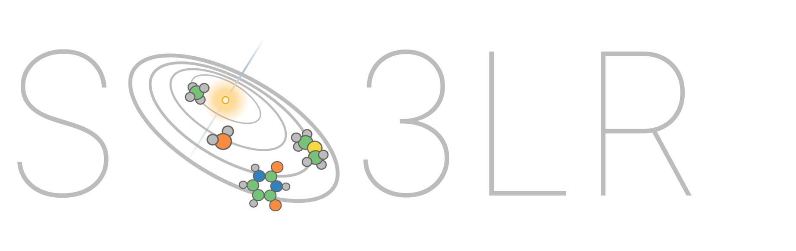

---
hide:
  - toc
---

# SO3LR { .so3lr-sr-only }

<div class="so3lr-hero" markdown>

</div>

<p class="so3lr-tagline" markdown>
SO3LR - pronounced *Solar* - is a pretrained machine-learned force field for
(bio)molecular simulations. It integrates the fast and stable SO3krates neural
network for semi-local interactions with universal pairwise force fields designed
for short-range repulsion, long-range electrostatics, and dispersion interactions.
See [GitHub](https://github.com/general-molecular-simulations/so3lr).
</p>

## Install

=== "uv"

    We recommend installing SO3LR with [uv](https://docs.astral.sh/uv/)
    (it's magical):

    ```shell
    git clone https://github.com/general-molecular-simulations/so3lr.git
    cd so3lr
    uv sync --locked --extra cuda12   # GPU; drop --extra cuda12 for CPU
    uv run so3lr --help
    ```

=== "pip"

    If JAX is already installed on your cluster (CUDA or ROCm), install SO3LR
    into that environment:

    ```shell
    git clone https://github.com/general-molecular-simulations/so3lr.git
    cd so3lr
    pip install .
    so3lr --help
    ```

See [Installation](installation.md) for optional extras.

## Example

=== "Command line"

    ```shell
    # 10 ps of NVT at 300 K
    so3lr nvt --input geometry.xyz --temperature 300 \
        --dt 0.5 --md-cycles 100 --md-steps 200
    ```

=== "ASE"

    ```python
    from ase.io import read
    from so3lr import So3lrCalculator

    atoms = read("geometry.xyz")
    atoms.calc = So3lrCalculator(model="so3lr-tauri-m")

    energy = atoms.get_potential_energy()
    forces = atoms.get_forces()
    ```

=== "JAX"

    ```python
    import jax.numpy as jnp
    from ase.io import read
    from jax_md import space, quantity
    from so3lr import So3lrPotential, to_jax_md

    atoms = read("molecule.xyz")     # an isolated molecule
    R = jnp.asarray(atoms.get_positions())
    displacement, _ = space.free()

    neighbor_fn, neighbor_fn_lr, energy_fn = to_jax_md(
        So3lrPotential(model="so3lr-tauri-m", lr_cutoff=100.0),
        displacement, box_size=None,
        species=jnp.asarray(atoms.get_atomic_numbers()),
        disable_cell_list=True, fractional_coordinates=False,
    )
    nbrs, nbrs_lr = neighbor_fn.allocate(R), neighbor_fn_lr.allocate(R)

    energy = energy_fn(R, neighbor=nbrs.idx, neighbor_lr=nbrs_lr.idx)
    forces = quantity.force(energy_fn)(R, neighbor=nbrs.idx, neighbor_lr=nbrs_lr.idx)
    ```

Try SO3LR without any local installation using our
[Colab notebook :material-open-in-new:](https://colab.research.google.com/github/general-molecular-simulations/so3lr/blob/main/examples/so3lr_colab_example.ipynb){ target=_blank }.

## Where to go next

| If you want to… | Go to |
|---|---|
| Get a first simulation running | [Quick start](quickstart.md) |
| Choose between `so3lr-tauri-s` / `-m` / `-l` | [Models](models.md) |
| See every CLI command and flag | [Command line](usage/cli.md) |
| Set up a production MD run, or use the flash engine | [Molecular dynamics](usage/md.md) |
| Look up a settings-file key | [Settings reference](usage/settings.md) |
| Score the model on your dataset | [Dataset evaluation](usage/evaluation.md) |
| Handle periodic electrostatics properly | [Long-range electrostatics](advanced/electrostatics.md) |
| Compute free energies | [Enhanced sampling](advanced/enhanced-sampling.md) |
| Adapt the model to your system | [Fine-tuning](training/finetuning.md) |
| Pull out energy components or charges | [Observables](advanced/observables.md) |

## Relevant references

- SO3LR: [*Molecular Simulations with a Pretrained Neural Network and
  Universal Pairwise Force Fields*](https://doi.org/10.1021/jacs.5c09558),
  JACS 147, 33723 (2025)
- SO3krates, the architecture SO3LR is built on: [*A Euclidean transformer
  for fast and stable machine learned force
  fields*](https://doi.org/10.1038/s41467-024-50620-6), Nat. Commun. 15,
  6539 (2024)

If you like SO3LR, please
[star it on GitHub](https://github.com/general-molecular-simulations/so3lr).
